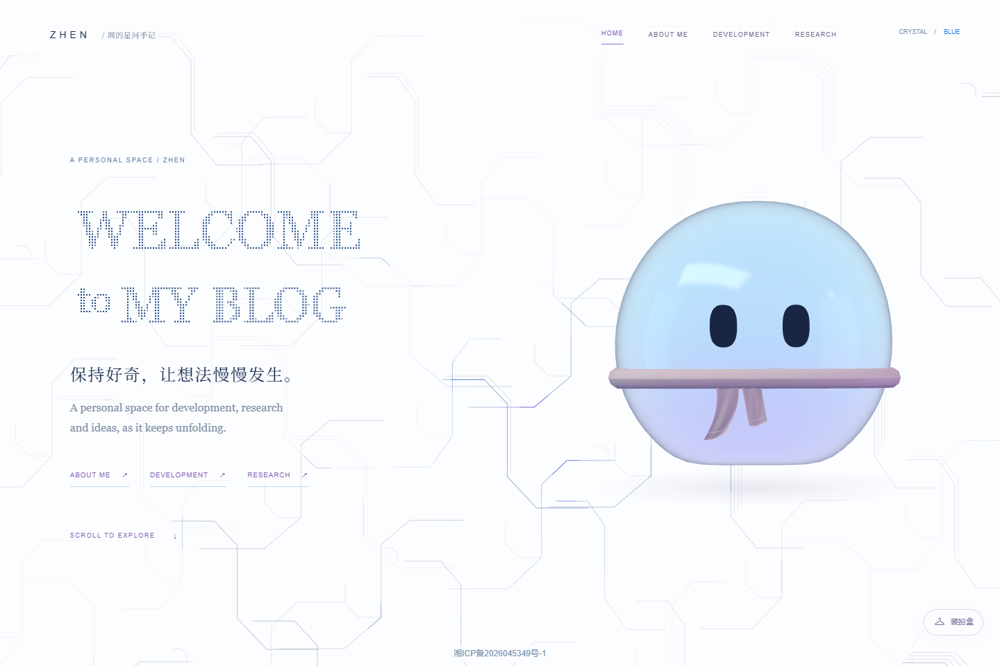
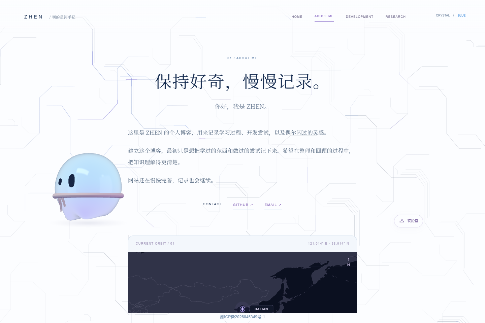
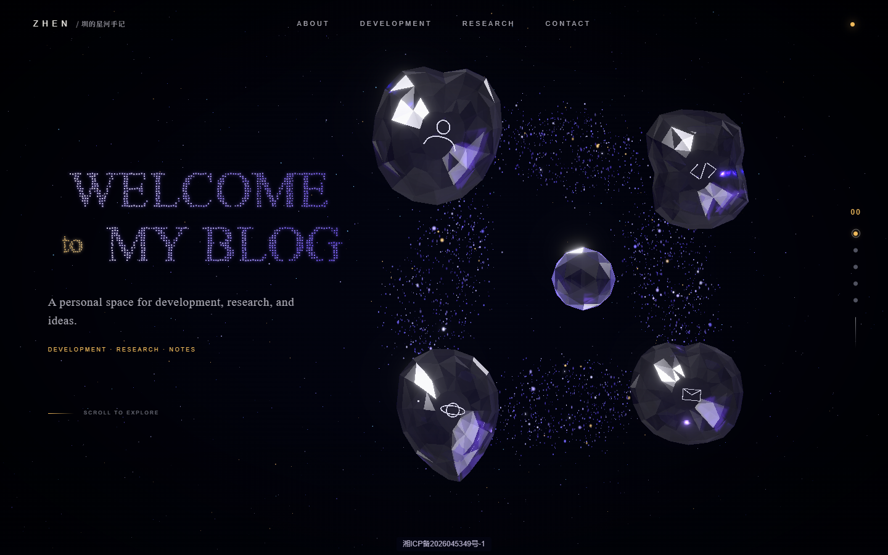
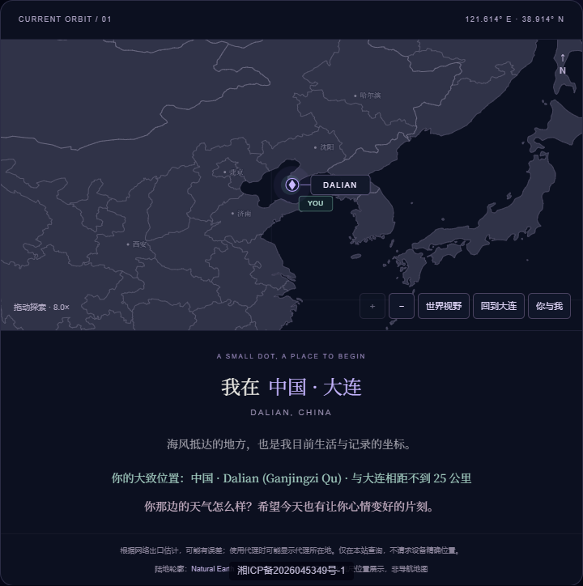
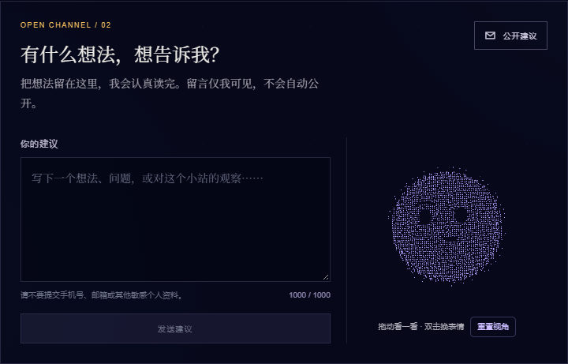

# 圳的星河手记 · Orbit Archive

基于 Vue 3、Vite、Vue Router 和 Three.js 的个人博客，提供晶体星河与蓝白阅读两种可切换界面。晶体版用 00–04 场景串联内容；蓝白版保留粒子欢迎文字、流动电路线背景与居中阅读布局，并加入可互动、可装扮的 3D 果冻伙伴。

[访问网站](https://zhen0504.cn/) · [关于我与访客地图](https://zhen0504.cn/#/about/profile)

## 页面预览

### 蓝白首页与果冻伙伴



### 陪伴式阅读



### 装扮互动


以上为 2026-10-23 本地版本实际截图，不代表线上已部署。角色支持表情过渡、轻点回应、闲置动作、后空翻与阅读页拖拽互动；装扮按头饰、眼镜和胸前配件组合，选择与装扮盒位置仅保存在当前浏览器。搭建过程见 [开发手记](content/development/building-my-blog.md)。

以下为原晶体版线上截图（2026-10-11），地图位置是网络出口的近似定位，不是设备精确位置。

### 水晶首页



### 访客地图



地图支持拖动、键盘平移、手动缩放和“你与我”视野。自动缩放根据访客与大连两点的跨度计算，不按城市写死倍率；低于 4 倍仅显示国界，达到 4 倍后显示数据覆盖地区的省级边界及画面内的少量城市名。城市标签会避开定位标记。位置与距离下方有十句随机问候，每次进入页面选择一句。

### 私密建议箱



建议箱连接 Python + SQLite 后端，保存成功后才显示成功；失败时保留输入。留言仅站长通过服务器命令查看，不会自动公开。支持长度校验、限流、防重复提交和机器人诱捕字段；当前没有网页管理后台。

## 技术与目录

- 前端：Vue 3、Vite、Vue Router；Three.js 晶体与粒子场景。
- 内容：Markdown + YAML 元数据，支持代码、数学公式与图片，HTML 经 DOMPurify 清理。
- 服务：Python 标准库 HTTP 服务 + SQLite；Nginx 转发 `/api/`。
- 地图：Natural Earth 静态 SVG；服务器使用本地 DB-IP City Lite 数据库估计城市，不调用外部定位 API。

```text
src/                 页面、组件与交互逻辑
content/             development / research 分类文章
public/              模型、图片和静态地图资源
backend/             私密留言、定位服务及测试
deploy/suggestions/  Nginx、systemd 与安装说明
tests/unit/          前端纯逻辑与结构检查
docs/images/         README 页面截图
tools/               地图和内容资源处理工具
```

## 运行与检查

```bash
npm install
npm run dev
npm run test:articles
npm run test:structure
npm run test:crystal
node tests/unit/map-location.test.mjs
node tests/unit/map-details.test.mjs
node tests/unit/site-registration.test.mjs
npm run build
npm run preview -- --host 127.0.0.1
```

仅运行前端也能预览页面，未启动后端时定位会降级、留言不能保存。完整本地开发需要 Python 3.10+，另开终端：

```bash
python backend/server.py --data-dir .local/suggestions --origins http://localhost:5173,http://127.0.0.1:5173
python -m unittest discover -s backend/tests -v
```

Vite 将 `/api/` 转发至 `127.0.0.1:8787`。城市定位还需要单独准备许可允许使用的 MMDB 数据及 `maxminddb` 读取库；没有数据库时返回定位不可用，不影响大连地图和其他页面。

## 部署与数据安全

`npm run build` 输出静态网站到 `dist/`，可由 Nginx 提供服务。线上留言服务仅监听回环地址，通过同域 `/api/` 访问，不需要开放额外公网端口。详细安装、查看留言、导出、备份与回滚步骤见 [部署说明](deploy/suggestions/README.md)。其中地图安装脚本含当前服务器的数据路径和已核验版本，其他环境需先核对并调整，不能直接假定数据库已经存在。

- 数据库、留言导出、备份、SSH 私钥和 GeoIP 数据库不包含在仓库中，也不能放进公开网站目录。
- 地图 API 只返回当前访问者的近似城市，不提供任意 IP 查询，不持久化定位记录。
- 留言限流使用带服务器密钥的 IP 指纹，不保存原始 IP；Nginx 访问日志可能仍记录 IP。
- GeoIP 数据库当前需人工核验并更新，没有自动更新任务。
- 网站名称和标签页显示“圳的星河手记”；页脚展示备案号与工信部链接。

地图数据及许可说明见 [地图资源说明](public/maps/README.md)。DB-IP City Lite 使用时须保留来源署名；本项目界面已保留链接。仓库未声明整体开源许可证，引用代码和素材前请核对各自授权。

使用 hash 路由，静态托管时可直接刷新：

- `/#/development`、`/#/research`：对应晶体与最新两篇文章。
- `/#/development/articles`、`/#/research/articles`：分类列表。
- `/#/development/articles/my-first-note`：文章详情，slug 为 Markdown 文件名去掉 `.md`。

## 新增文章

在 `content/development/` 或 `content/research/` 新建 UTF-8 Markdown 文件，例如 `my-first-note.md`。建议文件名使用小写英文、数字和连字符。无需修改路由或手工登记文章。

```markdown
---
title: 晶体场景开发笔记
date: 2026-09-21
summary: 记录一次场景运镜与阅读体验的实现。
tags: [Three.js, Vue, 开发笔记]
cover: /images/articles/my-first-note/cover.jpg
---

## 正文

支持中文段落、标题、列表、代码块、表格、引用和图片。


```

- `title`、`summary` 必须为非空字符串。
- `date` 必须是合法的 `YYYY-MM-DD` 日期，拒绝不存在的日期。
- `tags` 必须是字符串数组；允许 `[]`，数组内不允许空白、数字或对象。重复标签自动去重，标签在预览、列表和详情中可见。
- `cover` 可省略。提供时必须是非空的站内绝对路径（单个 `/` 开头）或 HTTP(S) 图片地址，详情页会显示封面。
- YAML 元数据错误的文章会被忽略，直链显示 `ARTICLE NOT FOUND`。可用 `npm run test:articles` 检查解析器规则；添加文章后也请在预览中确认其出现。
- 分类按日期降序排列，晶体页只显示最新两篇。无文章时隐藏卡片，保留 `VIEW ALL`，分类列表显示 `NO ARTICLES YET`。

将图片放入 `public/images/articles/<slug>/`，引用时不写 `public`。例如磁盘文件 `public/images/articles/my-first-note/cover.jpg` 对应 `/images/articles/my-first-note/cover.jpg`。发布到子目录时需要将图片 URL 配置为实际部署前缀。不要引用本机磁盘路径。图片说明使用 Markdown 的 alt 文本。

当前两个内容目录已包含博客开发与神经网络学习记录。正文 HTML 经过 DOMPurify 清理。

## 交互与维护

最新文章和 `VIEW ALL` 使用同一晶体进入动画。正常桌面约 1.7 秒后切换路由；遮罩由动画实际进度触发。移动端、减少动画、低帧率和 WebGL 不可用时使用简化紫色遮罩。返回按钮与返回对应分类的浏览器历史导航触发反向转场。

个人资料、项目和联系方式仍在 `src/data/portfolio.js`。00、01、04 的内容及 ZHEN 会话开场沿用现有实现。

公开仓库保留正式文章、源码、运行与部署说明及展示截图；内部设计、计划与验收过程记录由站长在本地保留。
